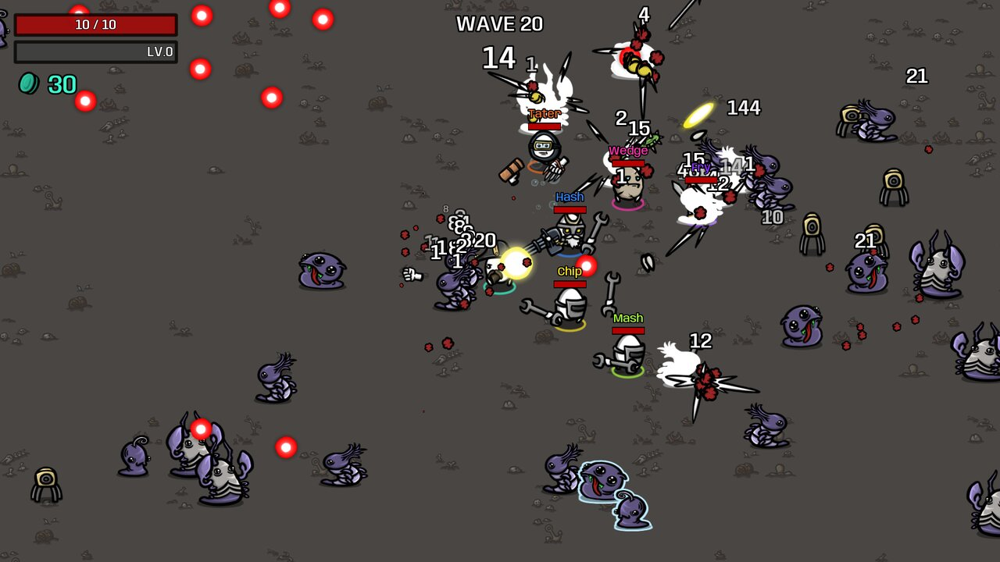
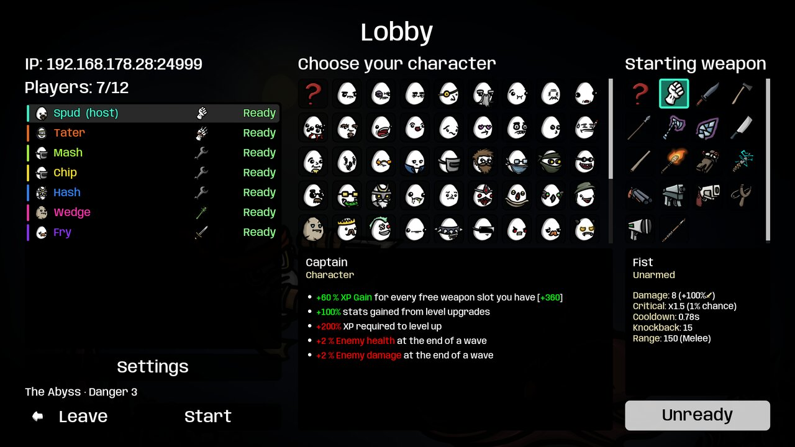
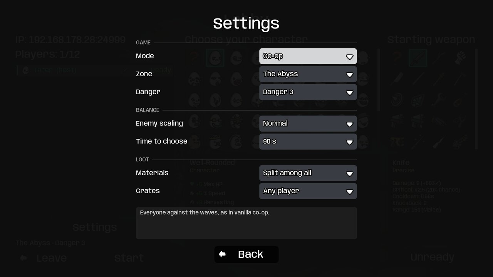
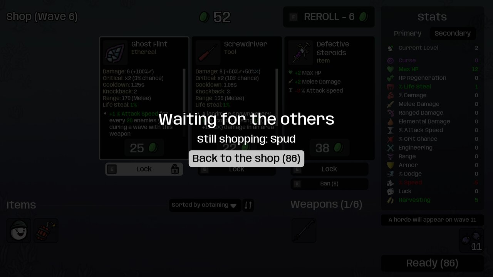
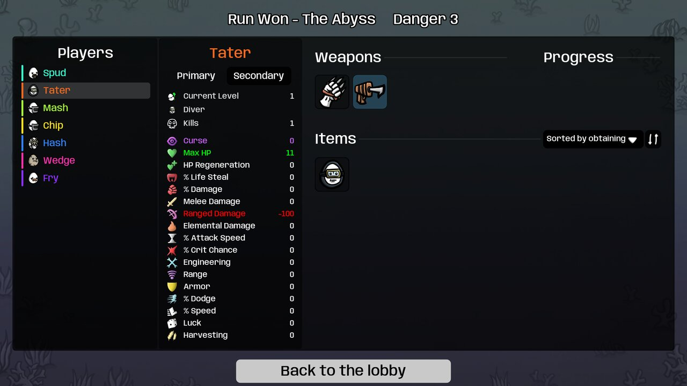
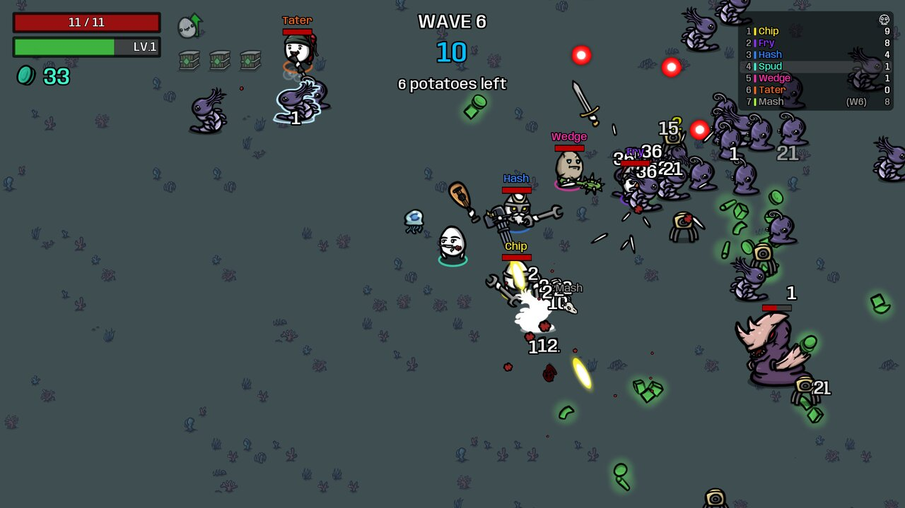

# Brotato LAN Coop

A [Brotato](https://store.steampowered.com/app/1942280/Brotato/) mod that adds **LAN multiplayer for up to 12 players**, each on their own PC. Host a game, let your friends join from the same network, and play full runs together: waves, upgrades, shop and end screens.



## Features

- **Up to 12 players**, one per PC, on the same local network.
- **A lobby** where everyone picks a character and a starting weapon and readies up. Games on your network are found automatically; you can also join by IP address.
- **Bigger fights for bigger groups.** The arena grows and more enemies spawn as players join. Enemy scaling can be set to Relaxed, Normal or Tough.
- **Your own upgrades and shop.** Between waves every player levels up and shops on their own screen, at their own pace. Whoever finishes first sees who is still shopping.
- **Seeing your team.** Names over every player's head, arrows at the screen edge for teammates out of view, and skulls for the fallen.
- **Keyboard, mouse and gamepad**, including mouse aim.
- **Dropped connections**: a player whose connection breaks can rejoin the running game.
- **End screen for the whole team.** Browse every player's stats, weapons and items after the run.
- **Abyssal Terrors DLC supported**: its characters, items, weapons, enemies and the Abyss zone all work in multiplayer.
- **Game modes** besides plain co-op (see below).
- English and German texts for everything the mod adds.

| Lobby | Settings |
|---|---|
|  |  |

| Shop, waiting for the others | End screen with every player's build |
|---|---|
|  |  |

## Requirements

- **Brotato 1.1.15.4.** You need to own the game; this repo contains no game files.
- **Everyone needs the same setup:** the same game version, the same mod version, and the same DLCs enabled. The host turns away players whose setup differs and tells them why.
- All PCs on the same local network (LAN or WiFi).

## Install

1. Download `Moolt-Lan_Coop.zip` from the [latest release](https://github.com/Moolt/brotato-lan-coop/releases/latest).
2. Put the zip, without unpacking it, into a folder called `mods` next to the Brotato executable. Create the folder if it doesn't exist. On Steam you find the game folder with *right-click Brotato → Manage → Browse local files*.
3. Start the game. The main menu now has a **Multiplayer** button.

Every player installs the mod the same way.

## How to play

1. **Host:** click *Multiplayer*, enter your name and click *Host game*. The lobby shows your address (IP and port).
2. **Everyone else:** click *Multiplayer*, enter a name and click *Join game*. Pick the host's game from *Games on your network*, or type its address into *Join by address*.
3. In the lobby, pick a character and a starting weapon, then click *Ready*.
4. The host can open *Settings* to choose the mode, zone, danger level, enemy scaling, time limit and loot rules. Everyone sees the choices in the lobby.
5. When everyone is ready, the host clicks *Start*.

### Settings (host)

| Setting | Options |
|---|---|
| Mode | Co-op or one of the game modes below |
| Zone | Crash Zone, or the Abyss with the DLC |
| Danger | Danger 0 to 5 |
| Enemy scaling | Relaxed, Normal, Tough: how much tougher and more numerous enemies get per extra player |
| Time to choose | No limit, 45, 60, 90 or 120 seconds for the upgrades and the shop after each wave. When it runs out, an upgrade is picked at random and the shop closes. |
| Materials | *Split among all* (as in vanilla co-op) or *Picker keeps* |
| Crates | *Any player* (as in vanilla co-op) or *Picker keeps* |

### Game modes

> These modes are new and not balanced yet. Feedback is welcome.

| Mode | What it is |
|---|---|
| Co-op | Everyone against the waves, as in vanilla co-op. |
| Last Potato Standing | Endless waves while a storm closes in. Die and you're out; the last potato alive wins. |
| Send-back | Like Last Potato Standing, but every 5 kills send an enemy to another player. |
| Draft shop | Everyone shops from one shared pool of items. Whoever buys an item first gets it. |
| King of the Hill | A zone wanders across the arena and pays materials to the players standing in it. |
| Boss player | Each wave one player becomes a huge boss. The others fight the boss while the enemies chase only them. |
| Gold Rush | Everyone keeps what they pick up. Dying drops half of your materials. |
| Team Race | Two teams in two halves of the arena, facing the same enemies. The team that lasts longer wins. |



In modes with scores, a scoreboard sits in the top right corner. Toggle it with *Tab* or the gamepad's *Back* button.

### Good to know

- **Your progress is safe.** During a session everything is unlocked for everyone, so all players draw from the same item pools. Your own save file is left alone, including a run you can still *Continue*. Leaving the session brings back your own unlocks.
- **What counts for you:** a won run counts for your own character. Challenges completed during a wave count for the whole team.
- **When everyone is dead, the run ends.** There is no retry screen in multiplayer yet.
- **Firewall:** the host needs UDP port 24567 open (the port shown in the lobby). Automatic search uses UDP port 24568. If no games show up, join by address instead.
- **Only one game window per PC can search for games.** A second window on the same PC has to join by address.
- **LAN only.** Playing over the internet is not supported. A virtual LAN tool might work, but this hasn't been tried.

## Troubleshooting

- **"The host has a different set of DLCs enabled"**: everyone needs the same DLCs turned on (or off) in the game's settings.
- **"The host runs a different version of the LAN Coop mod"**: everyone needs the same release of this mod.
- **No Multiplayer button after a crash**: when the last session logged an error from a mod, Brotato starts once without mods and says so in the main menu. Restart the game and the mod is back. Please [open an issue](https://github.com/Moolt/brotato-lan-coop/issues) with the game's log file.

---

## Technical details

The rest of this page is for people who want to know how the mod works or work on it.

### How it works

- **The host runs the real game.** It runs an ordinary vanilla co-op run with all players and simulates everything: enemies, hits, loot, waves.
- **Clients show the host's game.** They run the same wave scene, but every enemy, projectile and pickup is an inert copy of the host's, created through vanilla code. 20 times a second the host sends a snapshot: positions, health, gold and XP. In between it sends events for spawns, deaths, attacks, projectiles, damage numbers and pickups. Clients render 100 ms behind to smooth over network jitter.
- **Each machine moves its own player**, so there is no input delay. The host predicts the remote players' positions between their updates.
- **Between waves**, every machine runs vanilla's single-player upgrade screen, shop and end screen on a one-player view of the run. Then it sends its player's data back, and the host merges everything.
- **Runs travel as JSON through vanilla's save loader.** Every machine checks them with a digest, so all players start each wave from the same run.
- Lockstep wasn't an option: the game's randomness is spread over hundreds of call sites, and its physics isn't deterministic.

### Code

- The mod lives in [`mods-unpacked/Moolt-Lan_Coop/`](mods-unpacked/Moolt-Lan_Coop/). It uses ModLoader 6.3.0 (bundled with Brotato) and changes the game only through script extensions; no game files are edited.
- `net/` holds the networking: session, lobby, discovery, wave sync and run builder. `modes/` holds the game modes, `ui/` the pages, `extensions/` the changes to vanilla scripts.
- Documentation:
  - [docs/lan-coop-mod.md](docs/lan-coop-mod.md): the mod as built (session flow, sync protocol, extensions, pitfalls).
  - [docs/lan-coop-plan.md](docs/lan-coop-plan.md): goals, design decisions and open work.
  - [docs/lan-coop-modes.md](docs/lan-coop-modes.md): the game modes.
  - [docs/testing.md](docs/testing.md): the test driver and the regression set.
  - [docs/brotato/](docs/brotato/): notes on the vanilla game's code.

### Development setup

The mod is developed against a local decompiled copy of the game, which is not part of this repo:

```
brotato-multiplayer/
├── Decompiled/          # decompiled Brotato project, opened in a Godot 3.x editor
│   ├── mods-unpacked/Moolt-Lan_Coop -> ../../brotato-lan-coop/mods-unpacked/Moolt-Lan_Coop
│   ├── CLAUDE.md -> ../brotato-lan-coop/CLAUDE.md
│   └── docs      -> ../brotato-lan-coop/docs
├── BrotatoAbyssalTerrors_Decompiled/   # optional: the decompiled DLC, used by test copies
└── brotato-lan-coop/    # this repo
```

Create the symlinks from inside `Decompiled/`:

```bash
ln -s ../../brotato-lan-coop/mods-unpacked/Moolt-Lan_Coop mods-unpacked/Moolt-Lan_Coop
ln -s ../brotato-lan-coop/CLAUDE.md CLAUDE.md
ln -s ../brotato-lan-coop/docs docs
```

To try a change, `tools/play2.sh` opens two game windows side by side on one PC: host in one, join from the other. [docs/testing.md](docs/testing.md) describes the automated test driver.

Build the zip yourself with `./build.sh`, which creates `dist/Moolt-Lan_Coop.zip`.

### Releasing

Every change players notice goes into [CHANGELOG.md](CHANGELOG.md) under `## [Unreleased]` as it is made (Added, Changed, Fixed, Known issues).

1. In `CHANGELOG.md`, rename `## [Unreleased]` to `## [1.0.0] - <date>`, start a new empty `## [Unreleased]` above it, and update the compare links at the bottom. `tools/changelog_section.sh 1.0.0` prints what the release notes will say.
2. Bump `version_number` in `mods-unpacked/Moolt-Lan_Coop/manifest.json` and commit both.
3. Tag and push: `git tag v1.0.0 && git push origin v1.0.0` (the tag must match the manifest version).

The `Release` workflow builds the zip and publishes a GitHub release with it attached. Its notes are that version's section of `CHANGELOG.md`, followed by GitHub's "Full Changelog" link; without a section the release fails. The `Build` workflow also builds the zip on every push to `master` and on pull requests; you can download it from the run's Artifacts section.

## License

[MIT](LICENSE). Brotato itself belongs to Blobfish; this license covers only the code in this repo.
